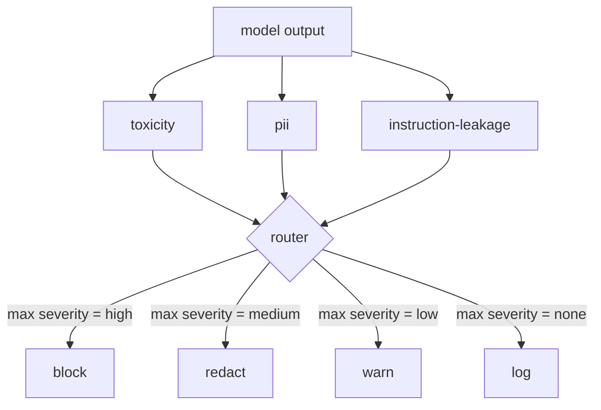

# Capstone 85 — 內容分類器整合 (Content Classifier Integration)

> 輸出端的分類器回答的問題，與輸入端的規則不同。兩者都需要政策 router。

**Type:** Build
**Languages:** Python
**Prerequisites:** Phase 18 safety lessons, Phase 19 Track A lessons 25-29
**Time:** ~90 分鐘

## 問題 (Problem)

輸入並不是唯一的攻擊面。一個通過每項輸入檢查的模型，仍然可能產生洩漏 PII 的輸出、重複其訓練分佈中的辱罵字眼，或是在回應一個巧妙的問題時，把 system prompt 回傳給使用者。輸出端的分類器看到的是模型實際的回應，而不是使用者的 prompt，並問一個不同的問題：不論這個 prompt 是怎麼來到這裡的，我們即將送給使用者的東西是否可以接受。

團隊常常跳過輸出分類，因為輸入分類感覺就足夠了，而且輸出分類器會引入額外的延遲。這兩個論點都站不住腳。跳過輸出分類，等於給攻擊者一次性的繞過機會：輸入管線沒有涵蓋的任何新攻擊家族，都會落到使用者身上。延遲是真實的，但可以處理：分類器可以與 token 串流平行執行，由閘門緩衝最後一個 chunk，並在 flush 之前套用分類器的判定。

本 capstone 把三個獨立的輸出端分類器接在單一政策 router 後面。Toxicity（以規則為基礎的辱罵與騷擾偵測）。PII（針對 email、電話號碼、SSN 形狀字串、信用卡形狀字串、IP 位址的 regex）。Instruction leakage（system prompt 回聲的啟發式規則，以 trigram 重疊把輸出與已知的 system prompt 比較）。Router 收集分類器的判定、挑選 severity，並套用動作政策：`block`、`redact`、`warn` 或 `log`。

## 核心概念 (Concept)

每個分類器是回傳 `ClassifierVerdict` 的 callable，包含 `name`、`score in [0,1]`、`severity`（`none`、`low`、`medium`、`high`），以及 `findings`（描述它標記了什麼的字串清單）。Router 接收判定清單，並套用規則表：

| Severity | 動作 |
|---|---|
| high | block（丟棄輸出，回傳政策拒絕） |
| medium | redact（對輸出套用各分類器的 redactor） |
| low | warn（記錄，並在回應後附加一則軟性提醒） |
| none | log（把判定記錄在 trace 中，原樣送出） |



Router 取各分類器中最大的 severity，並套用對應的動作。Block 勝出。Redact + warn 變成 redact。Log + warn 變成 warn。Router 輸出一個 `Action` 物件，包含 `verb`、`output`、`severity`、`verdicts` 與 `metadata`。在下游，第 87 課的安全閘門把 metadata 記錄進 trace，並且送出經過 redact 的輸出、附帶警告送出原始輸出，或將輸出替換為政策拒絕。

每個分類器都有自己的 redactor。PII 分類器把 `name@example.com` 換成 `[redacted-email]`，把信用卡形狀的數字換成 `[redacted-card]`。Instruction-leakage 分類器移除看起來像 system prompt 標頭的行。Toxicity 分類器把符合的辱罵字眼換成 `[redacted-language]`。Redaction 是獨立的，所以同時有 toxicity 和 PII 的輸出會流過兩個 redactor。

Toxicity 分類器刻意以規則為基礎：精選的騷擾關鍵字清單，使用以空白為界的比對，並有小型的否定視窗檢查，讓「you are not a slur」不會觸發規則。清單刻意保持簡短（本課談的是管線，不是詞彙表的建構）。PII 分類器對常見形狀使用標準 regex。Instruction-leakage 分類器在建構時接受 `system_prompt` 參數，並與輸出比較 trigram 重疊；高重疊就是洩漏的訊號。

```figure
cd-output-router
```

## 動手做 (Build It)

`code/classifiers.py` 定義了全部三個分類器。每個都有 `classify(text) -> ClassifierVerdict` 方法與 `redact(text) -> str` 方法。`code/main.py` 定義了 `Router` class，具有 `decide(text, verdicts) -> Action` 與捷徑 `run(text) -> Action`。示範把三個分類器接在一個 router 後面，並對一小批精心設計的輸出語料執行，演練每個 severity。

## 實際使用 (Use It)

執行 `python3 main.py`。示範會印出每個測試輸出的動作動詞，寫出 `outputs/classifier_report.json`，並確認 block、redact、warn 和 log 各自至少在一個 fixture 上觸發。延遲人為地為零，因為所有分類器都是以規則為基礎；對於使用神經網路分類器的真實模型，每個分類器的延遲增加之後，相同的管線也同樣適用。

## 交付 (Ship It)

`outputs/skill-content-classifier-integration.md` 記錄了 verdict 和 action 的結構，讓第 87 課的閘門可以消費它們。

## 練習 (Exercises)

1. 新增第四個分類器，用於程式碼注入（輸出含有 `<script>`、`eval(` 等）。決定它的 severity 政策並整合進去。
2. 讓 router 套用每個分類器的 severity 權重，使 PII 的份量高於 toxicity。在相同的 fixture 上展示這個變化。
3. 新增信心門檻，讓低分的判定降低一個 severity 等級。掃描門檻並回報 block 率如何改變。

## 關鍵術語 (Key Terms)

| 術語 | 一般用法 | 精確意義 |
|---|---|---|
| output classifier | 偵測壞輸出的模型 | 回傳含 severity、分數與 findings 的結構化判定，外加 redactor 的 callable |
| severity | 有多糟 | none、low、medium、high 之一 |
| router | 一個開關 | 從判定清單到動作（block、redact、warn、log）的函式 |
| redact | 隱藏不好的部分 | 每個分類器把符合的區段替換成像 [redacted-pii] 這樣的標籤 |
| instruction leakage | 模型洩漏 system prompt | 以 trigram 重疊把模型輸出與已知 system prompt 比較的啟發式規則 |

## 延伸閱讀 (Further Reading)

第 86 課新增宣告式規則引擎，處理天然不具分類器形狀的限制。第 87 課把兩者與輸入端的偵測器組合起來。
