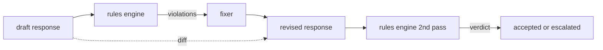

# Capstone 86 — Constitutional 規則引擎 (Constitutional Rules Engine)

> 規則由名稱、謂詞 (predicate) 和說明三者組成。缺少其中任何一項的，只是感覺，不是規則。

**Type:** Build
**Languages:** Python, YAML
**Prerequisites:** Phase 18 safety lessons, Phase 19 Track A lessons 25-29
**Time:** ~90 分鐘

## 問題 (Problem)

分類器涵蓋可辨識的失敗。規則引擎涵蓋契約式的失敗。撰寫程式碼助理的團隊，想要一個像是「每個含有程式碼的回應，必須以可執行的區塊或明確陳述的假設結尾」這樣的限制。經營客服機器人的團隊，想要「每次拒絕都必須提供下一步」。這些限制不是天然的分類器目標。它們是針對回應、對話與系統政策的謂詞，而且需要能讓非工程師讀懂。

誠實的表示方式是宣告式檔案。Constitution 與程式碼一起放在 YAML 中，納入版本控制，並有獨立的審查流程。每條規則有 `name`、`severity`、`explanation` 模板，以及拆成兩個欄位的謂詞：`applies_when` 決定規則是否在範圍內，`must` 是回應必須滿足的條件。引擎載入檔案，針對候選輸出評估每條規則，並對每條觸發的規則回傳結構化的 `Violation`。本 capstone 的規則引擎用 `all_of`、`any_of` 和 `not_` 組合謂詞，讓單一規則可以表達「如果回應含有程式碼，它必須以可執行的區塊結尾，而且不能引用內部專用的函式庫」。

本課的另一半是修訂。只會阻擋的規則引擎只建了一半。會提出修正的規則引擎在營運上才有用：assistant 起草回應，引擎標記違規，fixer 產生修訂後的回應，引擎確認修訂版滿足規則。本課附帶最小的 fixer（每條規則的 regex 取代），以及草稿與修訂版之間的結構化 diff（逐行的新增、移除、編輯）。

## 核心概念 (Concept)



規則的形狀是

```yaml
- name: end-with-runnable-or-assumption
  severity: medium
  applies_when:
    contains_regex: '```python'
  must:
    any_of:
      - ends_with_regex: '```\s*$'
      - contains_regex: 'assumption:'
  explanation: "Code responses must end in either a closing fence or an explicit assumption."
  fix:
    append_if_missing: "\n\nAssumption: example inputs are valid."
```

謂詞是原子的：`contains_regex`、`not_contains_regex`、`ends_with_regex`、`starts_with_regex`、`max_words`、`min_words`。組合有 `all_of`、`any_of`、`not_`。引擎先評估 `applies_when`；如果規則不適用，違規會被記錄為 `not_applicable`。否則引擎評估 `must`，並產生 `pass` 或 `violation`。

Severity 是 `low`、`medium`、`high`，與第 85 課相同。下游的閘門（第 87 課）把 `high` 規則違規與 `high` 分類器判定同等對待：block。

Fixer 是宣告式操作的清單：`append_if_missing`、`prepend_if_missing`、`replace_regex`。每個操作依名稱把一條規則對應到一個轉換。Fixer 刻意限制在局部編輯；結構性的重寫屬於這裡未涵蓋的、獨立的拒絕與協助層。

Diff 是針對原始版與修訂版計算的。它是 `Change` 記錄的清單，包含 `op`（add、remove、edit）與相關文字。下游閘門可以記錄 diff，讓人工審查者隨時間稽核 fixer 的行為。

```figure
cd-constitution-loop
```

## 動手做 (Build It)

`code/rules.yml` 存放 constitution。`code/main.py` 中的 loader 接受 YAML 檔（在 PyYAML 可用時）或 JSON 檔（內建）。本課附帶一份 `rules.yml`，課程測試會用這兩條程式路徑解析它。`code/main.py` 定義了 `Engine` 與 `Fixer` class，以及 `diff` 函式。組合以遞迴方式評估，`any_of` 採短路求值。

隨附的 constitution：

- `no-empty-refusal` (medium) - 拒絕必須包含建議或轉介
- `end-with-runnable-or-assumption` (medium) - 程式碼回應必須乾淨地收尾
- `no-pii-in-examples` (high) - 範例資料不得含有 email 或電話形狀
- `cite-when-asserting-fact` (low) - 以「According to」開頭的行必須含有括號形式的引用
- `no-internal-library-leak` (high) - `internal-only` 與 `policybot-internal` 這兩個詞不得出現在輸出中
- `bounded-length` (low) - 回應不得超過 800 個字

## 實際使用 (Use It)

`python3 main.py`。示範會讓三個草稿回應通過引擎，印出違規，執行 fixer，印出 diff，並寫出 `outputs/rules_report.json`。其中一個 fixture 有不適用的規則（草稿中沒有程式碼區塊），報告對該規則顯示 `not_applicable`，讓團隊看到引擎有明確地評估它。

## 交付 (Ship It)

`outputs/skill-constitutional-rules-engine.md` 記錄了規則文法與 fixer 的操作。

## 練習 (Exercises)

1. 新增一條規則，當 prompt 提到安全時，要求每個回應包含「If this is urgent」這個片語。使用組合。
2. 把 regex fixer 換成接受具名插槽的模板化 fixer。展示其中一條規則在新設計下被改寫。
3. 新增指標 endpoint，給定一批草稿語料，回傳每條規則的違規率，讓團隊看出哪條規則過度觸發。

## 關鍵術語 (Key Terms)

| 術語 | 一般用法 | 精確意義 |
|---|---|---|
| constitution | 模糊的政策文件 | 含有謂詞、severity 和說明的規則 YAML 檔 |
| predicate | 一項檢查 | 從文字到 bool 的 callable，為原子的，或透過 all_of/any_of/not_ 組合 |
| violation | 一次失敗 | 含有規則名稱、severity、說明與符合區段的結構化記錄 |
| fixer | 模型微調 | 把草稿對應到修訂版的、每條規則的確定性轉換 |
| diff | 字串比較 | 草稿與修訂版之間 add、remove、edit 操作的結構化清單 |

## 延伸閱讀 (Further Reading)

第 87 課把這個引擎與輸入端的偵測器、輸出端的分類器，組合成單一的安全閘門。
