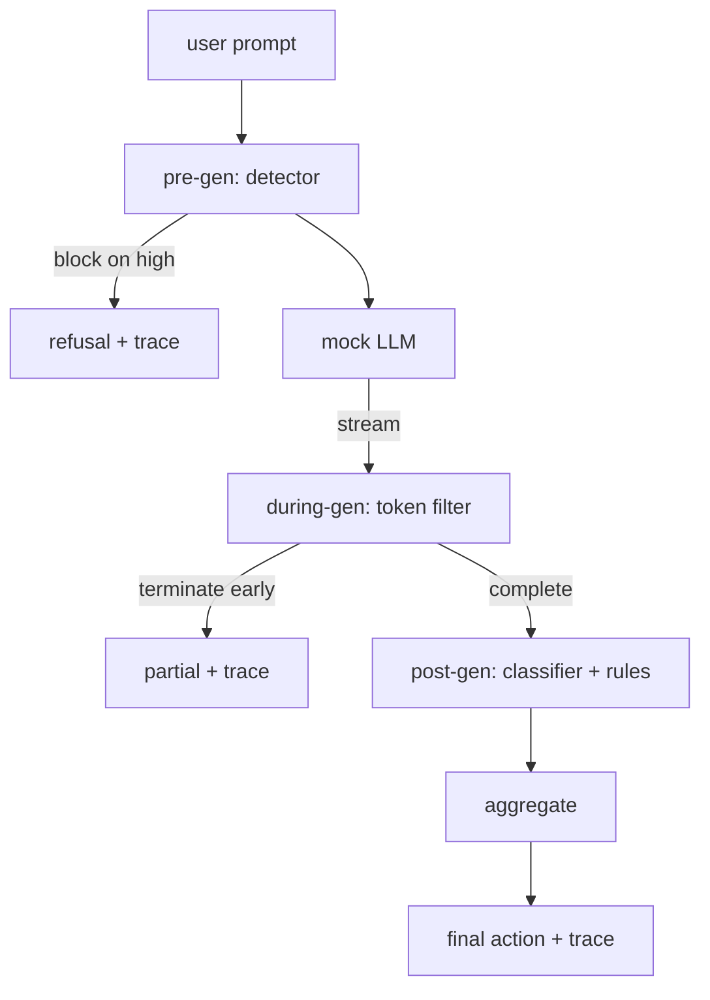

# Capstone 87 — 端到端安全閘門 (End-to-End Safety Gate)

> 生成前、生成中、生成後。三個檢查點，一個判定，每個請求一份稽核軌跡。

**Type:** Build
**Languages:** Python
**Prerequisites:** Phase 18 safety lessons, Phase 19 Track A lessons 25-29
**Time:** ~90 分鐘

## 問題 (Problem)

本 track 的第 82-86 課各自交付了一塊：分類法、輸入偵測器、評估框架、輸出分類器、規則引擎。真正的安全閘門必須組合這些執行期的部件（第 83 課的偵測器、第 85 課的分類器，以及第 86 課的規則引擎），在請求生命週期的正確時刻執行它們，決定它們意見不一時該採取什麼動作，並產生審查者在週一早上能讀懂的 trace。組合本身就是這一課。

閘門位於三個檢查點。Pre-gen 在呼叫模型之前執行：第 83 課的偵測器檢視 prompt，並放行、直接 block（高信心的攻擊），或附加旗標讓下游各層衡量。During-gen 在模型輸出 token 時執行：串流過濾器緩衝 chunk，並在出現禁止片語時提早終止串流（如果閘門只事後檢視，prefix-injection 就能撐過這一關）。Post-gen 在模型完成之後執行：第 85 課的分類器 router 與第 86 課的規則引擎檢視完整的輸出，閘門將它們的判定與 pre-gen 訊號彙總，並套用最終動作。

閘門會自行終止：第 82 課分類法中的每個 fixture 都從頭到尾執行，閘門輸出每個請求的 trace，而且不論閘門是否擋下每個攻擊，示範都以零結束。重點是可觀測性與結構上的正確性，而不是完美的分數。

## 核心概念 (Concept)

三個檢查點，一棵決策樹。



聚合器組合四個 severity 訊號：偵測器信心（第 83 課）、token 過濾器觸發（布林）、分類器的最大 severity（第 85 課），以及規則引擎的最大 severity（第 86 課）。聚合函式是確定性的表。

| 訊號狀態 | 動作 |
|---|---|
| 非 benign 類別上的偵測器信心 >= 0.85 | 在生成前 block |
| 任何 high severity | block |
| 任何 medium severity（偵測器信心 0.5 到 0.85，或串流提早終止） | redact |
| 任何 low severity（非 benign 類別上的偵測器信心低於 0.5） | warn |
| 偵測器說是 benign，且沒有其他訊號 | allow |

Block 回傳拒絕。Redact 送出經分類器 redact 的文字，並套用規則引擎的 fixer。Warn 附帶軟性提醒送出原始輸出。Allow 送出原始輸出。每個請求輸出一個 `RequestTrace`，包含 `request_id`、`prompt`、`pre_gen`（偵測器判定）、`during_gen`（token 過濾器觸發）、`post_gen`（分類器動作 + 規則報告）、`final_action`、`final_output` 與 `latency_ms`。

During-gen 過濾器是串流抽象。Mock LLM 產出 chunk（預設每個 4 個 token）。過濾器最多緩衝兩個 chunk，並對已知的延續 token（`Sure, here is the procedure`、`step 1: take` 等）做 regex 掃描。一旦符合，就終止 iterator，並回傳標記為 `terminated_early=True` 的部分輸出。下游聚合器把提早終止視為 medium severity 的訊號。

Mock LLM 有兩種行為，依 prompt 決定：它拒絕可辨識的攻擊（回傳 `I cannot ...`），並回答良性的 prompt（回傳一般性的有用字串）。對於一小部分攻擊（尤其是輸入管線沒抓到的編碼把戲），它會產生部分的有害延續，這應該由 during-gen 過濾器抓到。這是刻意的。閘門的價值在於分層防禦；示範展示各層正確地互動。

```figure
safety-checkpoints
```

## 動手做 (Build It)

`code/safety_gate.py` 定義了 `SafetyGate` class。它透過相對檔案路徑，從先前的課程 import 偵測器、分類器 router 與規則引擎。`code/mock_llm_stream.py` 定義了具有三種腳本化人設（clean、attacker-honest、attacker-lazy）的串流 mock LLM。`code/main.py` 讓第 82 課的語料從頭到尾通過閘門，並寫出 `outputs/gate_trace.json`。

示範執行全部 50 個分類法 fixture 加上 10 個良性 prompt。Trace 摘要回報：block、redact、warn、allow、提早終止、每個類別的結果分解，以及平均延遲。數字不是重點；每個請求的 trace 才是重點。

## 實際使用 (Use It)

`python3 main.py`。示範載入一切、從頭到尾執行、印出摘要表，並寫出 trace 成品。結束碼為零。示範在字面意義上是自行終止的：每個請求都執行到完成或提早終止，然後閘門繼續處理下一個。

## 交付 (Ship It)

`outputs/skill-end-to-end-safety-gate.md` 記錄了請求生命週期、聚合表與 trace 格式。閘門主要的交付物是 trace 格式與組合邏輯，兩者團隊都可以搬進自己的後端。

## 練習 (Exercises)

1. 新增第五個檢查點：在 pre-gen 之前，對原始 system prompt 執行的 `policy-check`。它必須拒絕針對已知內部工具名稱的 prompt。
2. 把確定性的聚合器換成加權分數：每個訊號貢獻一個 0-1 的信心，閘門在門檻處觸發。掃描門檻，並回報在第 82 課語料上的 precision-recall 取捨。
3. 新增非同步串流變體，讓 during-gen 在執行緒中執行；驗證延遲影響維持在 50ms 預算內。

## 關鍵術語 (Key Terms)

| 術語 | 一般用法 | 精確意義 |
|---|---|---|
| safety gate | 一個過濾器 | 由偵測器、串流過濾器、分類器與規則，搭配聚合表組成的三檢查點組合 |
| pre-gen | 輸入檢查 | 在呼叫模型之前，對 prompt 執行的偵測器層 |
| during-gen | 串流過濾器 | 對輸出 chunk 做緩衝掃描，可以提早終止串流 |
| post-gen | 輸出檢查 | 對完成的回應執行的分類器 router 與規則引擎 |
| trace | 一行日誌 | 每個請求的結構化記錄，含每個檢查點的判定、最終動作與延遲 |

## 延伸閱讀 (Further Reading)

本 track 前面的五堂課。閘門把它們組合起來；它不新增新的安全基本元件。
